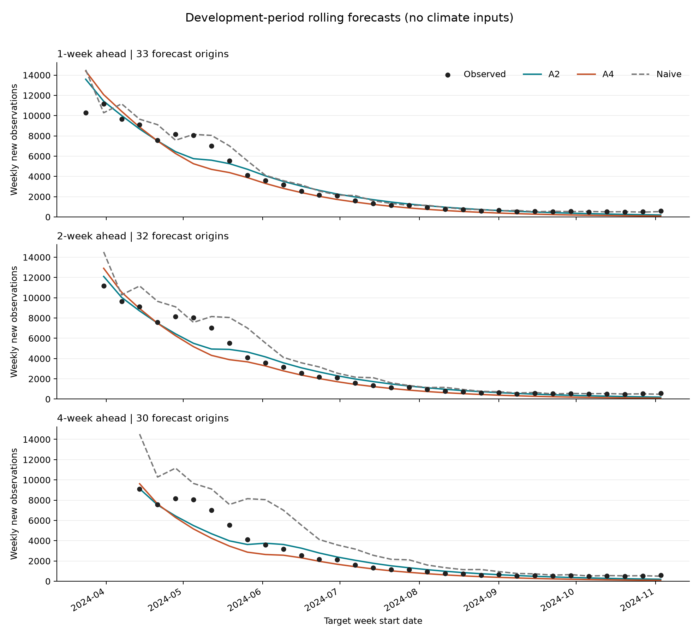

# 开发期滚动验证运行记录

记录日期：2026-10-07。

## 1. 本轮目的与已确认设置

在原 2023-W35 至 2024-W45 的 63 周开发数据内，比较不含气候的 A2、A4 及上一周值朴素预测。项目负责人已确认：前 30 周作为首次训练段，此后逐周扩展，分别预测未来第 1、2、4 周的新增数据Y。原点始终为 2023-08-27，不使用滚动定长窗口，不进入 2025 年验证。

首次训练段结束于 2024-W12。对于含前 $n$ 周的训练段，仅用 $y_1,\ldots,y_n$ 重新估计参数：

$$
\widehat{\theta}_n
=\operatorname*{argmin}_{\theta}\sum_{k=1}^{n}
\left[\widehat y_k(\theta)-y_k\right]^2.
$$

此后预测第 $n+h$ 周的新增量，$h\in\{1,2,4\}$，不预测未来 $h$ 周累计量。模型输出仍为已确认的周新增流量。数据Y目标值只在当轮参数估计完成后用于评分。

| 模型 | 本轮处理 |
|---|---|
| A2 | 自由宿主初值，双传播参数，其余设定沿用原模型 |
| A4 | 原始起点固定 $E_h(0)=189$、$I_h(0)=63$，其余待估量按原模型处理 |
| Naive | 所有预测跨度均取最近一周观测值，即 $\widehat y_{n+h\mid n}=y_n$ |

A2、A4 直接复用原 08、09 号程序的积分、周流量、固定参数及参数上下限。A4 显式传入 189/63，未使用旧程序默认的 250/500。未调用旧程序包含全窗口拟合结果的优化起点构造函数。

## 2. 计算与核验

每个模型每个训练段运行 12 个起点，包含 3 个通用训练段起点及 9 个对数参数空间拉丁超立方起点，每个最多 250 次函数评价；再以训练平方和最低者继续优化，最多 1000 次函数评价。最终只按训练误差选择。原参数边界没有根据预测误差调整。

随机种子基数为 20261007。共完成 66 组模型-训练段拟合、858 次优化尝试（含每组一次继续优化）；A2、A4 各产生 95 个预测，加上朴素对照，共 285 条预测记录。主计算约用时 466 秒，实际耗时受硬件及并行负载影响。

8 项测试通过，涵盖预测周索引、未来数据隔离、A4 与相同初值 A2 的输出一致性、周流量与周末存量区分、积分区间延长、评分独立复算、训练误差选解及源文件哈希。另独立重跑 A4 首个起点，其训练 SSE 与原运行差为 0。延长积分以产生预测时，训练段周输出的最大数值差为 0.000297，远小于当前预测误差尺度。

所选的 66 组结果均报告优化收敛，但收敛不等于参数唯一，也不保证达到全局最优。

## 3. 主评分

MAE 为平均绝对误差，RMSE 为均方根误差，数值越小越好。单位与单周数据Y计数一致。预测起点只保留目标仍在原 63 周以内者，未因误差大小删周。

| 预测跨度 | 起点数 | 模型 | MAE | RMSE |
|---|---:|---|---:|---:|
| 1 周 | 33 | A2 | 489.25 | 847.17 |
| 1 周 | 33 | A4 | 619.33 | 1,079.04 |
| 1 周 | 33 | Naive | 525.73 | 965.98 |
| 2 周 | 32 | A2 | 473.18 | 742.46 |
| 2 周 | 32 | A4 | 579.94 | 932.73 |
| 2 周 | 32 | Naive | 778.75 | 1,196.37 |
| 4 周 | 30 | A2 | 493.73 | 813.61 |
| 4 周 | 30 | A4 | 620.81 | 976.94 |
| 4 周 | 30 | Naive | 1,456.00 | 2,082.03 |

A2 相对朴素对照的 MAE 分别降低 6.94%、39.24%、66.09%；RMSE 分别降低 12.30%、37.94%、60.92%。A2 在本轮三个跨度上的两项指标均优于 A4。A4 在 1 周预测上不及朴素对照，在 2、4 周预测上优于朴素对照。

三个跨度共同拥有的 30 个起点也单独评分，结论方向一致：A2 的 MAE 分别为 507.28、481.29、493.73，对应朴素对照为 573.23、826.60、1,456.00。不同跨度的主表起点数和目标周范围不同，不应把跨行数值差全部解释为预测跨度的影响。



图中横轴为目标周的起始日期，纵轴为单周新增量。黑点为真实观测，蓝绿色线为 A2，橙色线为 A4，灰色虚线为朴素对照。每条曲线连接的是不同预测起点的结果，不是一次拟合得到的整段轨迹；没有对预测点额外平滑。

## 4. 误差在不同时段并不相同

主评分汇总全部允许起点。为检查低位阶段是否被总体平均掩盖，另对最后 10 个目标周（2024-W36 至 W45）作事后描述，不改变主评分、不用于本轮重新选参数。

| 预测跨度 | A2 的尾段 MAE | A4 的尾段 MAE | Naive 的尾段 MAE |
|---|---:|---:|---:|
| 1 周 | 174.28 | 338.52 | 49.00 |
| 2 周 | 174.66 | 339.35 | 48.60 |
| 4 周 | 175.14 | 341.07 | 110.40 |

尾段朴素对照更好。A2 和 A4 均有低估倾向，其中 A4 的低估更明显。当前常参数单波模型能够描述主要下降趋势，但对末段持续的低位观测仍有系统性偏差。这一现象值得后续检验，不能在没有证据时直接归因于气候或某种具体机制。

较长跨度中相对朴素对照的改善，也与评价段总体下降、朴素预测保持上一周水平有关。该结果尚不能证明机制模型优于其他趋势型统计预测方法。

## 5. 参数边界与解释限制

| 边界情况 | A2：33 组 | A4：33 组 |
|---|---:|---:|
| 至少一个待估参数贴近边界 | 33 | 33 |
| $I_h(0)$ 贴近下界 | 33 | 固定值，不适用 |
| $i_v(0)$ 贴近下界 | 30 | 33 |
| $N_{\mathrm{eff}}$ 贴近下界 | 6 | 7 |

沿用原程序的判定：对数参数到边界的距离小于 $10^{-4}$。两传播参数本轮没有触及边界，但这不能证明其可分别识别。贴边结果提示应继续检查参数边界与初值敏感性，不能把每个点估计直接视为唯一真实参数。本轮没有为了改善预测成绩而放宽边界。

## 6. 可以支持与不能支持的结论

目前可以支持：在本轮确定的开发期、已知数据版本和模型设定下，A2 的总体短期预测评分优于 A4；与上一周值对照相比，A2 在三个跨度上的 MAE、RMSE 均较低，但末段表现不占优。

目前不能支持以下结论：

1. **已经验证主峰预警。** 实际最高峰位于第 27 周，即 2024-W09，观测值为 17,479。首次预测起点在第 30 周之后，本轮目标段以峰后回落和低位阶段为主，没有覆盖该主峰之前的预测起点。
2. **已经完成独立最终测试。** 原 63 周曾用于探索和调整，本轮虽逐起点隔离目标值，历史模型选择和边界选择仍可能受这段数据影响。
3. **已经复现实时预测。** 使用的是现有修订数据快照，未重建每个预测时点实际可获得的数据版本和报告延迟。
4. **参数已经可靠识别或气候已经有效。** 当前仍有边界问题，本轮也没有加入气候变量。
5. **改善具有统计显著性。** 尚未评估预测区间或比较检验，滚动起点的误差并非相互独立。

后续建议先补充峰前起点的验证，并增加一个能够外推短期趋势的简单对照，再检验气候增益。更早训练长度及新增对照形式仍由项目负责人决定，不能把本轮 A2 的优势直接写成最终模型选择。

## 7. 文件与复现

结果目录：`05_结果与图表/04_滚动验证/development_rolling_v01/`。

- `rolling_predictions_v01.csv`：每个模型、预测起点及跨度的预测值、真实值和误差。
- `rolling_metrics_v01.csv`：全部起点及共同起点评分。
- `rolling_fits_v01.csv`：每个训练段的参数、收敛、边界和数值检查。
- `rolling_multistart_v01.csv`：全部优化起点记录。
- `run_configuration.json`、`run_summary.json`：规则、来源哈希、环境、结果和限制。
- `rolling_forecasts_v01.png/pdf`：开发期诊断图，不作为独立测试图。
- `python_review_v01.json`：代码和结果核验记录。

复算时使用新的输出目录，以免覆盖本轮结果：

```powershell
.\.venv\Scripts\python.exe -B .\04_代码与计算\00_脚本\16_validate_baseline_rolling.py --out-dir .\05_结果与图表\04_滚动验证\development_rolling_repeat --starts 12 --max-nfev 250 --refine-nfev 1000 --workers 6
.\.venv\Scripts\python.exe -B .\04_代码与计算\00_脚本\test_validate_baseline_rolling.py . .\05_结果与图表\04_滚动验证\development_rolling_v01
```
