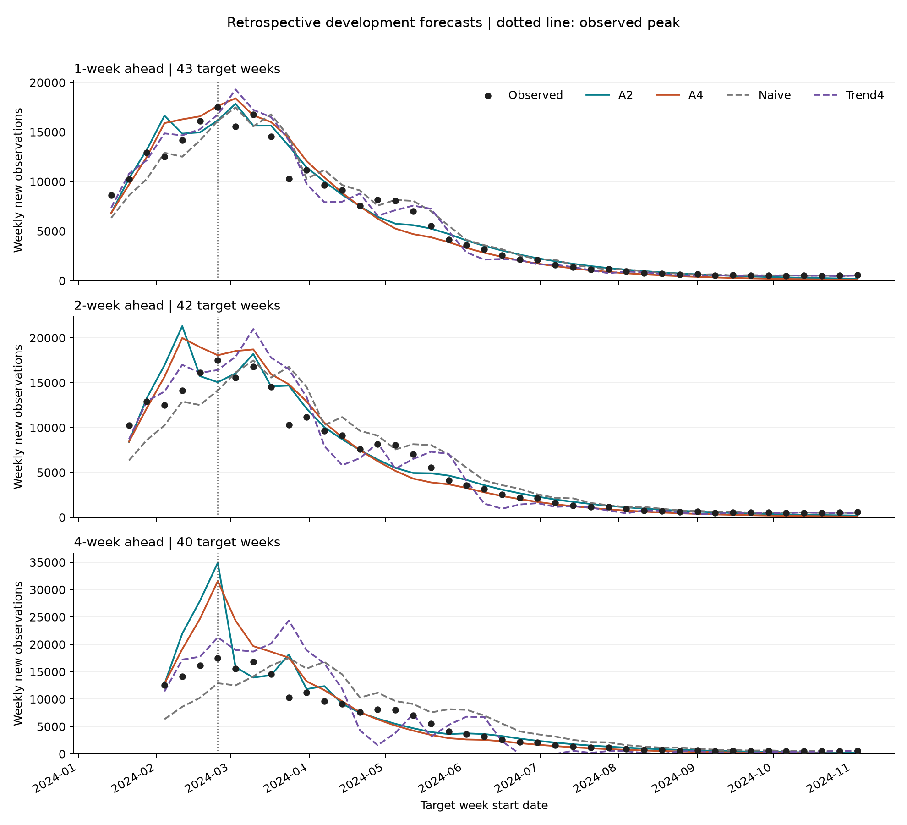
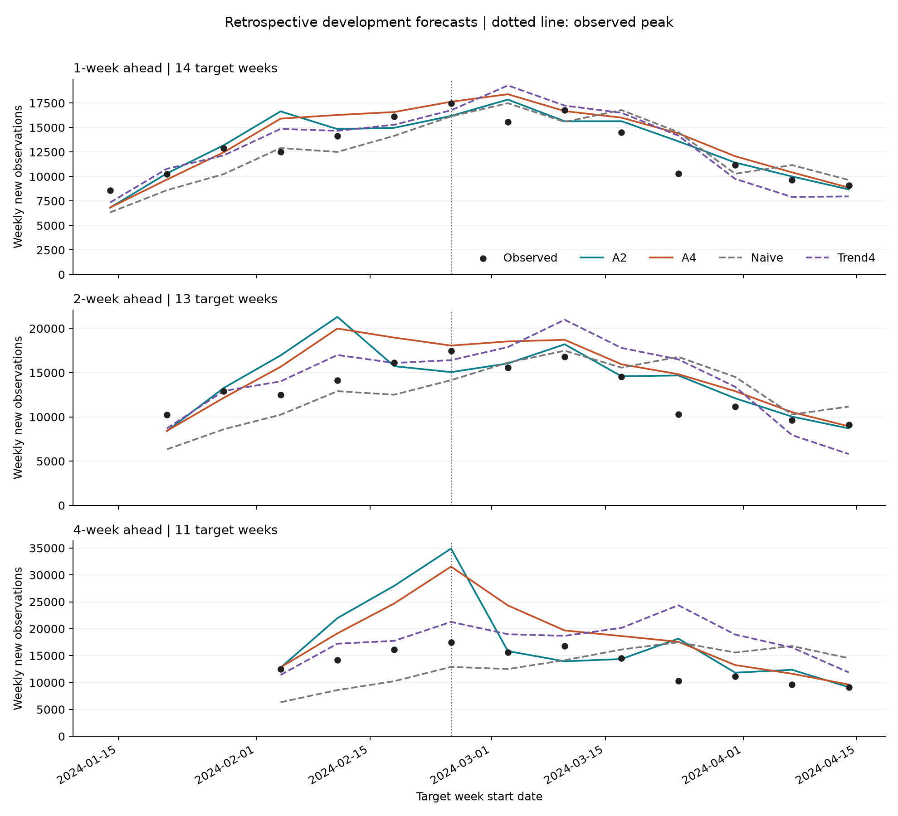
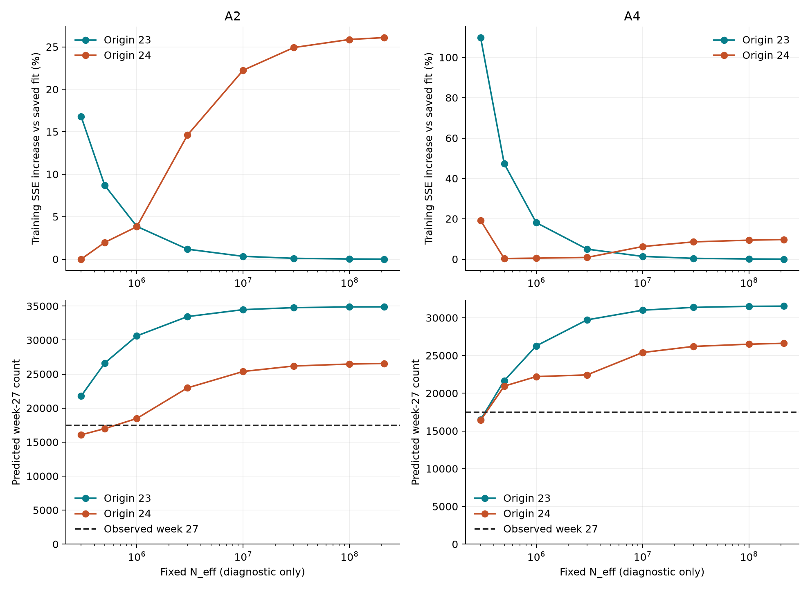

# 巴西全国周数据预测研究：朋辈导师进展汇报

整理日期：2026年10月14日。依据现有文献库、模型文档、运行记录、保存结果和最新已确认方案整理；本次未重新拟合模型，也未修改历史实验。沿用项目文档中的“疾病X”“数据Y”名称。

## 一、现在做到哪一步了

本项目研究巴西全国疾病X周新增数据的预测，希望在保留人—蚊传播机制的基础上，检验气候信息能否提高预测能力。目前已建立文献库和基础动力学模型，形成数学分析文档，整理监测数据与气候周数据，并完成无气候模型的滚动预测、简单预测方法对照和峰前误差诊断。

当前处于“基线模型验证与问题诊断之后、最小温度机制扩展之前”。已经发现值得继续研究的问题，但还不能说建立了稳定有效的气候预测模型。

现阶段最重要的结果是：自由初值模型在开发期总体平均绝对误差上较好，但峰前四周预测明显偏高。多起点拟合和参数剖面检查表明，这不只是一次优化偶然选错参数，而与常参数模型对增长和减速的表达、参数相互补偿有关。

## 二、从开始到现在的研究过程

| 顺序 | 做过的工作 | 已得到的材料或认识 | 当前定位 |
|---|---|---|---|
| 1 | 收集疾病X、其他蚊媒病、巴西监测及气候建模文献 | 本地保存21篇核心PDF，建立筛选矩阵、全文入口表和模型分类综述；C14仍无全文 | 文献基础，不等于21篇均已逐页精读 |
| 2 | 比较不同模型的仓室、观测方式和适用场景 | 采用宿主SEIR、蚊媒SEI结构，明确变量、参数、感染力与假设 | 已确定基础模型 |
| 3 | 开展基础模型数学分析 | 已形成非负性、有界性、疾病消除平衡点、基本再生数、局部稳定性和局部敏感性推导文档 | 结论适用于相应的常参数模型与假设 |
| 4 | 整理官方监测资料并形成全国周序列 | 建立清洗流程、质量记录、全国趋势图；选定2023-W35至2024-W45的63周开发窗口 | 已有可重复的数据处理流程 |
| 5 | 尝试参数与初始条件的不同设置 | 比较约束传播参数、双传播参数、自由宿主初值、固定250/500和189/63等设置 | 保留为模型探索过程，不将某次最优估计当作真实初值 |
| 6 | 检查累计曲线、周末存量与周新增量的区别 | 正式输出改为每周由暴露仓室进入感染仓室的流量；周末存量拟合的B组保留为历史对照 | 已明确正式观测口径 |
| 7 | 整理温度、降雨、湿度及站点覆盖 | 建立人口加权州均值气候周表，与数据Y使用一致周界；完成跨年周和缺测核查 | 可供开发期气候实验使用 |
| 8 | 从全段拟合转向滚动预测验证 | 先从30周起训，再补充至20周起训；逐周扩展训练段，预测未来第1、2、4周 | 已完成开发期回顾性滚动验证 |
| 9 | 加入简单方法与统计气候对照 | 完成上一周值、最近4周趋势和有／无气候岭回归比较 | 确认复杂模型并非各阶段均优于简单方法 |
| 10 | 诊断峰前四周过冲 | 复算286条优化记录，完成32个有效规模剖面点、128次剖面优化尝试 | 已区分参数分散、跨起点重估与共同过冲 |
| 11 | 准备最小温度机制扩展 | 已准备4周滞后温度输入并确认配对实验方向、比值情景和温度系数范围 | 方案与输入已准备；动力学气候拟合尚未运行 |

### 1. 基础模型和数学分析

宿主设置易感、暴露、感染和康复四个仓室；蚊媒设置易感、暴露和感染三个仓室。时间单位为天，观测单位为每周新增人数。基础版本暂不加入宿主自然出生死亡，蚊媒保留补充和死亡过程。

已有数学工作不是只写出方程，还包括解是否非负、是否有界，以及无感染状态附近的阈值分析。需要准确表述的是：由于当前模型不含宿主人口更新，疾病消除平衡点是一族平衡点；现有稳定性文档讨论感染方向或相应感染子系统的局部稳定性，不能简化为整个系统某个孤立平衡点的局部渐近稳定结论。以后加入时变温度项，也不能直接照搬常参数模型的阈值结论。

### 2. 监测数据与观测定义

当前开发窗口从2023年8月27日至2024年11月9日，共63周。按症状开始日期DT_SIN_PRI重建流行病学周，每周为星期日至星期六，不采用周一开始的ISO周。

周编码核查发现，2024年原始SEM_PRI与日期重建周次不一致的22,983条记录均来自州代码32，原编号均早一周。现行分析按日期重建周次，同时保留原字段；这是确定了差异分布和处理规则，不是已经查明上游系统为何产生偏移。

当前程序将排除CLASSI_FIN=5后的记录计为probable，即保留未排除记录，包括分类缺失记录。对外报告时应明确这一实际操作规则，不能称为全部实验室确诊人数；其与官方统计定义、未结案记录和不同年度编码的对应关系，应以原始字典和处理记录作为依据，避免把“周界已核清”写成“所有数据定义均无剩余问题”。

正式模型每周输出为：

$$
\widehat y_k=qN_{\mathrm{eff}}\int_{7(k-1)}^{7k}\sigma_he_h(t)\,dt.
$$

其中，e_h为暴露宿主比例，N_eff为模型中的有效规模。首轮固定q=1属于观测尺度假设，不代表真实报告率已知为100%。由潜伏期结束流量近似对应症状开始周，也是需要保留说明的观测假设。

参数估计采用训练周上的残差平方和：

$$
\widehat\theta=\underset{\theta\in\Theta}{\arg\min}\sum_{k\in\mathcal T}\left[\widehat y_k(\theta)-y_k\right]^2.
$$

历史累计曲线可以展示总量变化，但不能替代正式周新增预测的验证。感染仓室存量、周新增量和累计量是不同的量，不能仅因曲线接近就混用。

### 3. 气候数据准备

现有2023—2025年全国气候主候选表共157周。先由合格站点计算州均值，再按固定的2024年州人口权重汇总；缺值州按变量、按周重新归一化权重。温度与湿度要求站点周至少有135个有效小时，主降雨变量要求完整168小时。气象小时先转换为站点当地时间，再与数据Y按同样的周界对齐。

已补齐跨入2026年的2025-W53。2025-W43和W52仍存在降雨覆盖问题，尤其W52仅一个州有合格数据，不能将其当作全国降雨。有效州人口占比不是实际气象观测的人口空间覆盖率；全国平均气候也不能完全代表各地暴露条件。

## 三、已经得到的主要实验结果

### 1. 正式比较的模型

| 模型 | 设置 | 用途 |
|---|---|---|
| A2 | 自由估计两项传播参数、有效规模和初始E_h、I_h、感染蚊媒比例 | 检查自由初值模型的预测能力 |
| A4 | 在同一原始起点固定E_h(0)=189、I_h(0)=63，估计其余参数 | 检查固定宿主初值是否提高稳定性 |
| 上一周值 | 直接用最新一周观测预测未来目标周 | 最简单的可用预测基线 |
| 最近4周趋势 | 用最近4周拟合直线并外推，负预测截为0 | 检查动力学模型是否超过简单趋势 |

滚动验证不是每次重新指定一个起始日期。模型仍从原始时间起点积分，逐次加入已经观测到的新一周并重新估计参数，然后预测未来目标周。未来第4周指该周本身的新增数，不是未来四周合计。

### 2. 为什么补充峰前验证

最初以30周为首次训练段，但实际主峰位于第27周，这样无法评价对这次主峰的提前预测。因此补充从20周起训的回顾性实验，并保留原有起点。未来第1、2、4周分别有43、42、40个可评分起点；同一跨度内，各模型使用相同目标进行比较。

| 模型 | 第1周MAE | 第2周MAE | 第4周MAE | 第4周RMSE |
|---|---:|---:|---:|---:|
| A2 | 700.40 | 907.91 | 1,666.38 | 3,880.06 |
| A4 | 784.62 | 1,056.67 | 1,841.42 | 3,492.40 |
| 上一周值 | 806.02 | 1,247.76 | 2,297.68 | 3,144.55 |
| 最近4周趋势 | 749.65 | 1,112.47 | 2,221.33 | 3,550.15 |

以上为全部可用起点结果，误差针对周新增人数。MAE表示平均绝对误差；RMSE对少数大误差更敏感。A2在表中三个跨度的MAE最低，但第4周RMSE较差，说明平均表现较好仍可能伴随严重的个别过冲。后期低水平阶段也不是动力学模型始终占优。

实际主峰当周及之前的目标周数量较少，第1、2、4周预测分别只有7、6、4个。这个子集内，最近4周趋势的MAE和RMSE均优于A2、A4。因此目前不能宣称已经实现可靠的峰前预警。

### 3. 最直观的峰前过冲

从第23周末提前四周预测同一个第27周，即2024-W09：

| 项目 | 目标周新增数 |
|---|---:|
| 实际观测 | 17,479 |
| A2预测 | 34,885.85 |
| A4预测 | 约31,541.60 |
| 最近4周趋势预测 | 21,265.80 |

A2和A4分别高估约99.59%和80.45%。这里评价的是对已知目标周新增量的预测，不是模型是否提前识别了峰值日期。

### 4. 对过冲的进一步诊断

第一，同一起点存在明显的参数相互补偿。第23周的A2近优解中，两项传播参数各自最大与最小值相差约38.87倍，但传播参数乘积相对稳定，四周预测仍集中在34,866.74至34,899.75。多组近优解都偏高，不能主要归咎于某一次优化偶然选错。

第二，新增一周数据后，模型可能大幅改变解释。加入第24周的短暂回落后，A2有效规模由约2.13亿变为30万下界，对同一个第27周的预测由约34,886变为16,067。前后预测跨度分别为4周和3周，该比较用于检查信息更新，不是两个同跨度预测的公平评分。有效规模的变化不代表实际人口在一周内骤减。

第三，增加优化次数不能保证解决模型表达问题。固定有效规模的剖面计算、高精度积分复算以及多起点检查支持这样的诊断：在峰前信息不足时，常参数模型容易继续外推增长；增加短暂回落信息后，又依赖规模和易感耗竭效应来调整轨迹。这是对模型行为的解释，不是对真实流行减速原因的因果证明。

近优解范围不等于置信区间，有限的参数搜索也不构成严格的结构不可辨识证明。现在能确定的是，单个传播参数和有效规模的解释应谨慎。

### 5. 气候信息的初步统计对照

已完成一个独立的岭回归实验：在最近新增量与趋势的基础上，加入起点当周温度、湿度和降雨，比较相同框架中有／无气候的表现。

| 预测跨度 | 无气候MAE | 加气候MAE | MAE降幅 |
|---|---:|---:|---:|
| 第1周 | 956.05 | 1,049.13 | -9.74% |
| 第2周 | 1,518.85 | 1,465.85 | 3.49% |
| 第4周 | 4,608.79 | 3,625.02 | 21.35% |

两个较长跨度有所改善，但一周预测变差；加气候后的整体误差仍未优于A2或简单趋势。该实验说明气候信息值得进一步检验，不能写成“动力学模型加入温度已改善21.35%”，也不能把三项气候的联合结果归因于温度一项。

## 四、当前不能作为已完成成果的事项

1. 尚未完成单温度机制模型的拟合，未得到它能否缓解峰前过冲的结果。
2. 尚未形成真正独立的最终测试。现有63周反复参与探索，属于开发期回顾性验证；按起点切分并不使这段数据重新变成未接触过的测试集。
3. 尚未验证真实发布时点下的实时预测。现有数据是后续修订快照，气象数据发布延迟也未完整纳入。
4. 尚未给出完整的参数不确定性、预测区间和显著性检验结论。
5. 尚未完成全国模型的区域稳健性验证；全国气候均值可能掩盖地区差异。
6. 尚不能证明温度因果作用，不能把一组拟合参数当作可靠的生物学测量值，也不能据当前结果保证论文创新性或录用。

## 五、已经确认的下一步

下一轮不再同时增加多项气候机制，而是检验一个问题：在控制参数复杂度后，加入一个温度项能否减少峰前过冲，同时维持整体预测表现。

已确认只增加一个温度作用系数，首轮使用4周滞后。63个目标周所需的滞后温度均有值，最低覆盖26个有效州，有效州人口占比最低99.663%。该滞后首先服务于预测时输入可用性，不代表已经找到了最佳生物学滞后。

最新对话已确认三个固定传播率比值情景β_h/β_v=0.1、1、10，温度系数η限制在[-1,1]，其余参数沿用A2原范围。每个情景都比较有／无温度模型，并继续保留A2、A4、上一周值和趋势对照。固定比值后，无温度模型估计5个参数，有温度模型只多估计1个η；这些比值是诊断约束，不认定某个值是真实机制。

这项选择晚于现有10月7日总档案和方案记录；旧文档中的“比值及系数范围待确认”已经落后于最新对话。本汇报记录最新状态，但原方案和决策日志还需在正式执行前同步。时变传播率的边界实现与周界积分也需逐项核对，不能将完成输入核查等同于完成模型求解。

后续按以下顺序推进：

1. 同步已确认约束，检查温度系数为零时能恢复对应无气候模型，再运行三个情景的配对滚动验证。
2. 同时看总体MAE、RMSE、峰前四周误差、参数贴边及温度系数方向，不只挑选平均误差较低的一组。
3. 根据结果判断：保留最小温度扩展、调整约束，或承认当前扩展没有稳定增益；不以已知未来峰值反向选择参数。
4. 与导师确定独立验证安排，核实其他年份的既往使用情况、监测数据修订和气候缺口。2025年不是天然未使用的测试集，需先确认。
5. 在验证方案稳定后补充不确定性与区域稳健性，再收敛论文问题和贡献表述。

## 六、向朋辈导师汇报的讲述顺序

建议控制在8—10分钟，不从文件夹逐个讲起。

| 时间 | 讲什么 | 要让对方听明白的内容 |
|---|---|---|
| 约1分钟 | 研究目标 | 用全国监测数据做周新增预测，检验气候是否带来额外信息 |
| 约2分钟 | 数据和基础模型 | 已统一周界及观测定义，已有SEIR-SEI和数学推导 |
| 约2分钟 | 实验过程 | 从拟合曲线转向滚动验证，同时比较固定／自由初值与简单方法 |
| 约2分钟 | 主要结果和问题 | 整体MAE较好，但峰前明显过冲，参数解释不稳 |
| 约1—2分钟 | 下一步与请教事项 | 做低复杂度温度配对实验，讨论独立验证和论文定位 |

可以直接这样开场：

> 我这段时间主要做了三部分工作：先把文献、模型假设和数据口径建立起来，再做参数拟合和滚动预测，最近集中检查峰前预测为什么偏高。现在已经有一套能重复运行的无气候基线，也有简单方法的对照。结果是自由初值模型的整体平均误差较低，但提前四周预测主峰时接近高估一倍，所以还不能说模型预测能力稳定。
>
> 我进一步检查了不同优化起点和有效规模，发现很多拟合得同样好的参数组合都给出过高预测；增加一周数据以后，有效规模又会大幅变化。因此当前问题不只是把优化算法换一下，而是怎样在有限数据下约束模型，并让它合理表达增长减速。下一步已经决定只增加一个温度系数，与同样约束的无气候模型配对比较。目前温度数据准备好了，实验还没有运行。我想请您帮我判断，这个推进顺序是否合理，以及独立验证和论文主线应该如何安排。

最值得请教的三个问题：

1. 当前应优先解决有效规模和参数弱辨识问题，还是先完成最小温度配对实验，再依据证据决定是否改变模型结构？
2. 在原63周已充分探索的情况下，如何安排另一时段或地区的独立验证，并明确数据发布时间和气候可用性？
3. 论文是否应以“预测能力及其适用边界”为主线，而将机制解释保持在与现有证据相称的范围内？

## 七、汇报时只打开这些材料

本稿作为讲述入口；下面三张现有图用于展示结果，无需逐个打开所有脚本和历史版本。

### 图1：整体滚动预测

讲述重点：预测按时间向前推进；平均表现和不同阶段表现必须分开看。

### 图2：峰前预测

讲述重点：主峰之前有哪些可用信息，提前四周时为什么出现较大过冲，简单趋势是否已经能做到更好。

### 图3：有效规模剖面诊断

讲述重点：训练拟合相近不保证参数确定或预测正确；不能根据已知峰值倒选一个看起来较准的规模。图中范围和剖面不是置信区间。

| 需要追问的内容 | 依据文件 |
|---|---|
| 核心文献及全文状态 | [全文获取状态与入口](../../01_文献与综述/03_参考文献库/全文获取状态与入口_v01.md) |
| 模型方程、假设和理论 | [基础模型方程](../../03_模型与方法/00_模型设定/基础模型方程系统_v01.md)、[局部稳定性分析](../../03_模型与方法/00_模型设定/疾病消除平衡点局部稳定性分析_v01.md)；其余推导在同目录 |
| 每周到底统计什么、模型输出什么 | [数据与观测口径](../../02_数据/03_数据字典/数据与观测口径_周界_v01.md) |
| 本稿滚动验证数值 | [原始评分表](../../05_结果与图表/04_滚动验证/development_peak_trend_v01/rolling_metrics.csv) |
| 气候统计对照数值 | [配对气候增益表](../../05_结果与图表/04_滚动验证/climate_increment_screen_v01/paired_climate_gain.csv) |
| 参数不稳与峰前过冲 | [峰前过冲诊断](../../04_代码与计算/03_运行记录/峰前过冲诊断_v01.md) |
| 下一轮温度机制设计 | [单温度机制扩展方案](../../03_模型与方法/01_参数估计/单温度机制扩展_方案_v01.md)，结合本稿第五节的最新确认状态阅读 |

整理方式建议：文献、原始数据、代码和历史结果继续各自保存；汇报只使用本稿、三张图和需要追问的依据文件。先明确阅读入口，再另行审查哪些内容应归档，不在汇报准备中删除实验记录。
